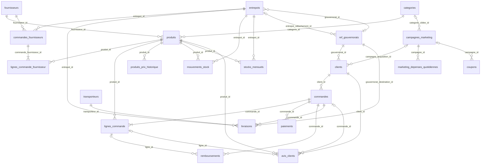

# TuniShop — ERD physique SQL Server

## Périmètre et origine
Ce modèle est dérivé des colonnes réellement présentes dans `donnees_reference/tunishop_reference.sqlite` et des CSV de `donnees_brutes`. La base de référence contient 22 tables métier et calendaires. Les fichiers mensuels des commandes et lignes sont à consolider dans les tables RAW correspondantes. Le fichier `paiements.jsonl` doit être chargé dans `raw.paiements_jsonl`, puis transformé en `clean.paiements`.

## Architecture
- `STG_TUNISHOP.raw` : colonnes source conservées en `NVARCHAR(4000)` pour absorber les erreurs de format, plus métadonnées d'ingestion. Pas de PK/FK métier imposées.
- `STG_TUNISHOP.clean` : types SQL Server, PK sur identifiants source. Pas de FK physiques par défaut afin d'isoler les lignes orphelines sans bloquer le chargement; les contrôles FK sont exécutés par tests de qualité.
- `STG_TUNISHOP.integ` : mêmes colonnes métier typées, PK et FK physiques après validation des orphelins. Les FK listées sont des relations logiques issues des colonnes disponibles; valider les données avant exécution en production.
- `DW_TUNISHOP.dim` et `.fact` : modèle dimensionnel avec clés substituts et FK physiques.

## Tables sources et clés métier
| Table | PK métier proposée | Cardinalités principales |
|---|---|---|
| `categories` | `categorie_id` | 1 catégorie → N produits; 1 catégorie → N campagnes ciblées |
| `fournisseurs` | `fournisseur_id` | 1 fournisseur → N produits et N commandes fournisseurs |
| `produits` | `produit_id` | 1 produit → N lignes de vente, historiques de prix, mouvements, snapshots, achats et avis |
| `clients` | `client_id` | 1 client → N commandes, avis; gouvernorat/campagne d'acquisition optionnels |
| `commandes` | `commande_id` | 1 commande → N lignes, paiements, livraisons, remboursements et avis |
| `lignes_commande` | `ligne_id` | N lignes par commande; 1 produit par ligne; remboursement/avis peuvent référencer une ligne |
| `paiements` | `paiement_id` | 1 commande → N tentatives/transactions |
| `remboursements` | `remboursement_id` | remboursement → commande obligatoire, ligne facultative |
| `entrepots` | `entrepot_id` | 1 entrepôt → N mouvements, snapshots, achats et livraisons |
| `mouvements_stock` | `mouvement_id` | N mouvements par produit et entrepôt |
| `stocks_mensuels` | `inventaire_id` | N snapshots par produit/entrepôt au fil du temps |
| `commandes_fournisseurs` | `commande_fournisseur_id` | 1 commande fournisseur → N lignes |
| `lignes_commande_fournisseur` | `ligne_cf_id` | chaque ligne référence un produit |
| `livraisons` | `livraison_id` | une commande peut avoir plusieurs livraisons; chaque livraison référence un transporteur et un entrepôt |
| `campagnes_marketing` | `campagne_id` | 1 campagne → N dépenses quotidiennes; coupons liés si identifiants concordants |
| `coupons` | `code_coupon` | 1 coupon peut être appliqué à N commandes; relation facultative |
| `marketing_depenses_quotidiennes` | `depense_id` | chaque dépense référence une campagne; grain date/canal/campagne à valider |
| `avis_clients` | `avis_id` | chaque avis référence client, produit; commande et ligne peuvent être nulles |
| `produits_prix_historique` | `prix_id` | 1 produit → N périodes de prix |
| `ref_gouvernorats` | `gouvernorat_id` | 1 gouvernorat → N clients, entrepôts et destinations; rattachement entrepôt optionnel |
| `transporteurs` | `transporteur_id` | 1 transporteur → N livraisons |
| `dim_calendrier` | `date` | calendrier de référence, 1 date par jour |

## Types SQL Server
- Identifiants métier : `NVARCHAR(50)` afin de conserver les préfixes et zéros initiaux (`CLI0001`, `PRD0001`).
- Montants : `DECIMAL(19,4)` plutôt que `FLOAT` pour les calculs financiers.
- Dates calendaires : `DATE`; horodatages : `DATETIME2(0)`.
- Drapeaux : `BIT`; compteurs : `INT` ou `BIGINT` si les volumes l'exigent.
- Commentaires : `NVARCHAR(2000)`.

Les types de CLEAN/INTEG sont des choix SQL Server typés selon les colonnes et exemples source. Pour `date_naissance`, les sources utilisent parfois `dd/mm/yyyy`; il faut parser avec une règle de conversion explicite (style 103), et conserver la valeur source en RAW.

## Grain des faits DWH
- `fact.FactSales` : une ligne par `ligne_id`, pas une ligne par commande. Les frais de livraison et la remise au niveau commande ne doivent pas être répétés sur chaque ligne sans règle d'allocation documentée.
- `fact.FactPayment` : une ligne par `paiement_id` (tentative/transaction).
- `fact.FactRefund` : une ligne par `remboursement_id`.
- `fact.FactStockMovement` : une ligne par `mouvement_id`; quantité signée selon `type_mouvement` et règle métier à documenter.
- `fact.FactStockSnapshot` : une ligne par `inventaire_id`; stock semi-additif dans le temps.
- `fact.FactPurchase` : une ligne par `ligne_cf_id`, avec les dates de commande, livraison prévue et réception associées.
- `fact.FactDelivery` : une ligne par `livraison_id`.
- `fact.FactMarketing` : une ligne par `depense_id`; le grain date/campagne/canal doit être vérifié avant d'ajouter une contrainte composite.
- `fact.FactCustomerReview` : une ligne par `avis_id`.

## Relations DWH et cardinalités
- Chaque dimension peut être référencée par N lignes de faits (1:N).
- Chaque ligne de fait référence une occurrence de dimension via sa clé substitut (N:1).
- `DimCustomer` et `DimProduct` sont conçues en SCD Type 2 : plusieurs versions peuvent exister par identifiant métier. Lors du chargement des faits, la clé substitut doit correspondre à la version valide à la date de l'événement.
- La relation client–produit est indirecte via les faits; ne crée pas de FK directe entre dimensions.
- `FactStockSnapshot` est un snapshot périodique; ne somme pas le stock sur plusieurs dates pour produire un stock courant.

## Ordre de chargement
1. RAW : référentiels, clients, produits, entrepôts, transporteurs, campagnes/coupons/calendrier.
2. RAW : commandes et lignes; paiements JSONL; achats et lignes; stocks, livraisons, remboursements, marketing et avis.
3. CLEAN : conversion des types, déduplication contrôlée, tests PK, domaines et dates; rejets dans `audit.RejectedRows`.
4. INTEG : charger les référentiels parents, puis les enfants; contrôler les FK orphelines avant d'activer les contraintes.
5. DWH : `DimDate`, dimensions métier, puis faits; Lookup vers clés substituts; gérer les lignes inconnues via une clé spéciale documentée si nécessaire.

## Vérifications indispensables avant exécution finale
1. Exécuter les tests de doublons et d'orphelins sur chaque FK proposée. Les tables SQLite source n'imposent pas de contraintes physiques.
2. Valider si les lignes de commande ont bien un `num_ligne` unique par commande; la contrainte proposée est `UNIQUE(commande_id,num_ligne)`.
3. Vérifier les cardinalités réelles commande–livraison, commande–paiement et commande–remboursement.
4. Les colonnes `campagne_id`, `code_coupon`, gouvernorat et entrepôt sont facultatives dans certaines sources; les FK nullable sont donc prévues.
5. Pour les paiements, privilégier `paiements.jsonl` comme source brute officielle et rapprocher les données parsées avec `donnees_reference/paiements.csv`.
6. La relation `reference_id` des mouvements de stock est polymorphe et ne doit pas être une FK vers une seule table. `DimReferenceType` est à alimenter seulement si le type de référence peut être identifié depuis la source ou une règle fiable.
7. Pour les dates du DWH, utiliser `YYYYMMDD` comme `DateKey`; une clé spéciale `0` peut représenter une date inconnue si la politique de chargement l'autorise.

## Fichier SQL
Le script `TuniShop_ERD_Physique_SQLServer.sql` crée les schémas RAW/CLEAN/INTEG, les tables de suivi, les dimensions et les faits du DWH. Il est destiné à être revu et exécuté par lots, pas à être lancé aveuglément en production : les contraintes FK INTEG peuvent échouer si des orphelins subsistent.

## ERD physique — relations INTEGRATED

## ERD physique — DWH étoile

```mermaid
erDiagram
    DimDate ||--o{ FactSales : DateKey
    DimCustomer ||--o{ FactSales : CustomerKey
    DimProduct ||--o{ FactSales : ProductKey
    DimOrderStatus o|--o{ FactSales : OrderStatusKey
    DimChannel o|--o{ FactSales : ChannelKey
    DimDate ||--o{ FactPayment : DateKey
    DimDate o|--o{ FactPayment : SettlementDateKey
    DimCustomer ||--o{ FactPayment : CustomerKey
    DimPaymentMethod ||--o{ FactPayment : PaymentMethodKey
    DimDate o|--o{ FactRefund : DateKey
    DimCustomer ||--o{ FactRefund : CustomerKey
    DimProduct o|--o{ FactRefund : ProductKey
    DimDate ||--o{ FactStockMovement : DateKey
    DimProduct ||--o{ FactStockMovement : ProductKey
    DimWarehouse ||--o{ FactStockMovement : WarehouseKey
    DimMovementType ||--o{ FactStockMovement : MovementTypeKey
    DimReferenceType o|--o{ FactStockMovement : ReferenceTypeKey
    DimDate ||--o{ FactStockSnapshot : DateKey
    DimProduct ||--o{ FactStockSnapshot : ProductKey
    DimWarehouse ||--o{ FactStockSnapshot : WarehouseKey
    DimDate ||--o{ FactPurchase : DateKey
    DimDate o|--o{ FactPurchase : ExpectedDeliveryDateKey
    DimDate o|--o{ FactPurchase : ActualReceiptDateKey
    DimSupplier ||--o{ FactPurchase : SupplierKey
    DimProduct ||--o{ FactPurchase : ProductKey
    DimWarehouse o|--o{ FactPurchase : WarehouseKey
    DimDate o|--o{ FactDelivery : ShipmentDateKey
    DimDate o|--o{ FactDelivery : PlannedDeliveryDateKey
    DimDate o|--o{ FactDelivery : ActualDeliveryDateKey
    DimCustomer o|--o{ FactDelivery : CustomerKey
    DimWarehouse o|--o{ FactDelivery : WarehouseKey
    DimCarrier o|--o{ FactDelivery : CarrierKey
    DimDate ||--o{ FactMarketing : DateKey
    DimCampaign o|--o{ FactMarketing : CampaignKey
    DimChannel o|--o{ FactMarketing : ChannelKey
    DimDate o|--o{ FactCustomerReview : DateKey
    DimCustomer ||--o{ FactCustomerReview : CustomerKey
    DimProduct ||--o{ FactCustomerReview : ProductKey
```

## À propos des cardinalités optionnelles
Le symbole `o|` indique qu'une FK peut être nulle. Les relations 1:N indiquent le modèle cible, mais la conformité des données doit être testée. La relation gouvernorat–entrepôt est circulaire dans les colonnes sources (`entrepots.gouvernorat_id` et `ref_gouvernorats.entrepot_rattachement_id`); il est recommandé de valider les données et de charger ces deux tables avant d'ajouter ces deux FK.
