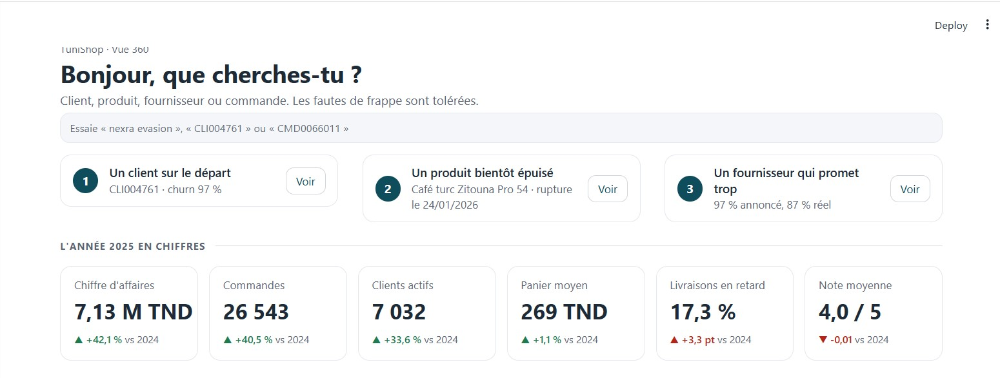
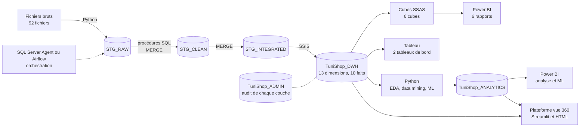
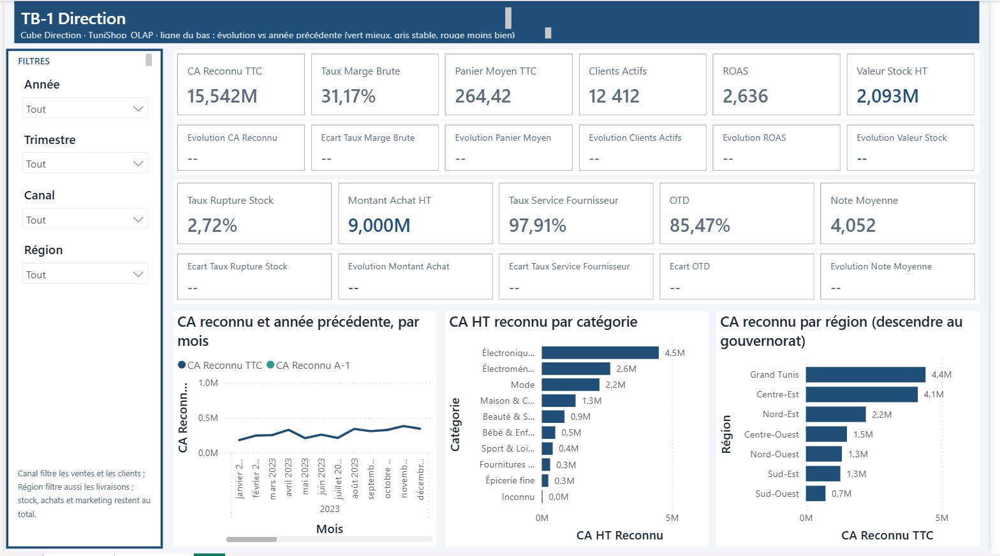
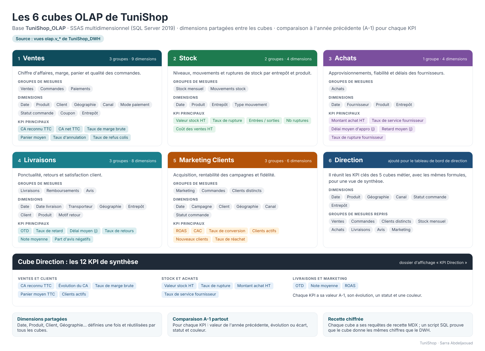

# TuniShop · Projet data et BI de bout en bout

**Sarra Abdeljaouad** · Data / BI  · [LinkdeIN](https://www.linkedin.com/in/sarra-abdeljaouad-927282451/) · [Plateforme en ligne](https://tunishopsarraapps.streamlit.app)

TuniShop est une enseigne e-commerce tunisienne **fictive**. Toutes les données sont **synthétiques**.
Ce dépôt montre la chaîne complète : des fichiers bruts jusqu'aux décisions, en passant par le staging,
l'entrepôt de données, les cubes OLAP, les tableaux de bord, l'analyse, le machine learning et l'automatisation.



## Voir le projet en 2 minutes

| Ce que tu veux voir | Où |
|---|---|
| La plateforme de recherche vue 360 (en ligne) | [tunishopsarraapps.streamlit.app](https://tunishopsarraapps.streamlit.app) |
| La même plateforme en site statique | (https://sarraabdeljaouad-ui.github.io/Tunishop-plateforme-360-web/) |
| Les résultats d'analyse et de ML | [`06_analyses_ml/04_Livrables/Phase_Analyse/Rapport_Final_Global_Phase_Analyse.pdf`](06_analyses_ml/04_Livrables/Phase_Analyse/Rapport_Final_Global_Phase_Analyse.pdf) |
| Les tableaux de bord | [`05_tableaux_de_bord/validation/04_Captures`](05_tableaux_de_bord/validation/04_Captures) |
| Le modèle de données | [`03_modele_decisionnel/schemas`](03_modele_decisionnel/schemas) |

## Architecture



## Les étapes du projet

| # | Étape | Technologies | Dossier |
|---|---|---|---|
| 0 | Cadrage, besoins métier, gouvernance des données, conception technique | Documentation, draw.io | [`00_cadrage_conception`](00_cadrage_conception) |
| 1 | Staging en 3 couches (RAW, CLEAN, INTEGRATED), incrémental, journal des rejets | Python, T-SQL | [`01_staging`](01_staging) |
| 2 | Entrepôt de données : 13 dimensions (dont SCD2), 10 faits, 23 vues `bi` | SQL Server, SSIS | [`02_dwh`](02_dwh) |
| 3 | Modèle décisionnel : constellation, un schéma par fait | Conception | [`03_modele_decisionnel`](03_modele_decisionnel) |
| 4 | Cubes OLAP : 6 cubes (Ventes, Stock, Achats, Livraisons, Marketing Clients, Direction) | SSAS multidimensionnel, MDX | [`04_cubes_ssas`](04_cubes_ssas) |
| 5 | Tableaux de bord : 6 rapports Power BI, 2 tableaux de bord Tableau, comparaison N-1 | Power BI (PBIP, DAX), Tableau | [`05_tableaux_de_bord`](05_tableaux_de_bord) |
| 6 | Analyses et ML : EDA, segmentation, text mining des avis, 4 modèles | Python, scikit-learn, Power BI | [`06_analyses_ml`](06_analyses_ml) |
| 7 | Automatisation de la chaîne complète | SQL Server Agent, Airflow, Docker | [`07_automatisation`](07_automatisation) |
| 8 | Plateforme de recherche vue 360 (client, produit, fournisseur, commande, transporteur) | Streamlit, HTML/JS | [`08_plateforme_vue360`](08_plateforme_vue360) |

Chaque étape a été recettée : rapport de validation, contrôles chiffrés (Excel) et procès-verbal (dossiers `validation/`).

### Aperçu

**Tableau de bord Power BI : synthèse de direction**



**Les 6 cubes OLAP (SSAS)**



## Résultats clés du machine learning

Test sur 2025, année jamais vue à l'apprentissage. Un modèle n'est retenu que s'il bat une référence simple.

| Cas | Modèle retenu | Mesure | Modèle | Référence |
|---|---|---|---|---|
| Ventes mensuelles par catégorie | Ridge « calendrier » | MAPE | **9,5 %** | 15,3 % (Holt-Winters) |
| Churn à 90 jours | Gradient boosting | AUC | **0,818** | 0,794 (règle « récence ») |
| Demande par produit | Catégorie × part produit | WAPE | **47,5 %** | 47,7 % (moyenne N-1) |
| Retard de livraison | Régression logistique | AUC | **0,811** | 0,728 (règle transporteur) |

Détail, limites et équité : [`06_analyses_ml/README.md`](06_analyses_ml/README.md).

## Compétences mises en œuvre

- **Data engineering** : ingestion Python, chargement incrémental (MERGE), suppressions logiques, audit et journal des rejets.
- **BI** : modélisation dimensionnelle, SCD2, SSIS, SSAS multidimensionnel, MDX, Power BI (PBIP, DAX), Tableau.
- **Analyse et ML** : validation temporelle, comparaison à une référence, explication des scores, suivi de dérive, tests pytest.
- **Industrialisation** : orchestration SQL Server Agent et Airflow sous Docker, recette documentée à chaque étape.
- **Produit** : plateforme de recherche floue avec fiches 360, déployée en ligne.

## Reproduire le projet

Prérequis : Windows, SQL Server 2019 Developer (moteur + Agent + SSAS multidimensionnel), SSMS,
Visual Studio avec les extensions SSIS et SSAS, Python 3.10+, ODBC Driver 17 ou 18, Power BI Desktop, Tableau Desktop.
Docker Desktop seulement pour le mode Airflow.

1. Données : elles sont dans [`data/`](data) (22 tables, 568 525 lignes, 94 fichiers sources). Mode d'emploi dans [`data/README.md`](data/README.md).
2. Suivre les README dans l'ordre des dossiers `01` à `07`.
3. Aucun mot de passe n'est stocké dans ce dépôt : authentification Windows, ou variable d'environnement `TUNISHOP_MDP`.

## Dépôts liés

| Dépôt | Contenu |
|---|---|
| [tunishop-plateforme-360](https://github.com/sarraabdeljaouad-ui/tunishop-plateforme-360) | Plateforme vue 360, version Streamlit |
| [tunishop-plateforme-360-web](https://github.com/sarraabdeljaouad-ui/tunishop-plateforme-360-web) | Plateforme vue 360, version HTML (GitHub Pages) |

## Organisation du dépôt

```
tunishop-projet-data-bi/
├── 00_cadrage_conception/   besoins métier, pilotage, gouvernance, architecture, spécifications
├── 01_staging/              SQL de création des bases, pipeline Python, validation
├── 02_dwh/                  SQL du DWH, projet SSIS, dictionnaire, validation
├── 03_modele_decisionnel/   schémas en étoile et conception
├── 04_cubes_ssas/           projet Visual Studio, MDX, XMLA, validation
├── 05_tableaux_de_bord/     Power BI (.pbip), Tableau (.twb), maquettes, validation
├── 06_analyses_ml/          notebooks, module Python, tests, exports, Power BI de l'analyse
├── 07_automatisation/       mode A (SQL Server Agent), mode B (Airflow + Docker)
├── 08_plateforme_vue360/    conception, maquettes, recette de la plateforme
└── data/                    le jeu de données : fichiers bruts, référence, documentation, générateur
```

---
Projet réalisé par Sarra Abdeljaouad. Données : « TuniShop - jeu de données synthétique », entièrement fictives (aucune personne ni entreprise réelle).
