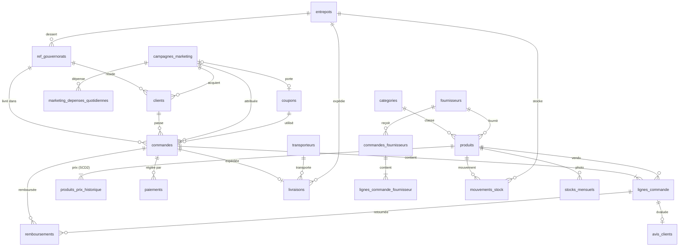

# Données TuniShop

Ce dossier contient le jeu de données utilisé par tout le projet.
« TuniShop - jeu de données synthétique » : toutes les données sont fictives, aucune personne ni entreprise réelle.

## Utilisation dans ce projet

Le pipeline de staging lit `donnees_brutes/`. La commande `reference` compare le résultat à `donnees_reference/`.
Depuis la racine du dépôt :

```powershell
$env:TUNISHOP_DOSSIER     = "$PWD\data\donnees_brutes"
$env:TUNISHOP_DOSSIER_REF = "$PWD\data\donnees_reference"
python 01_staging\python\tunishop_pipeline.py tout
python 01_staging\python\tunishop_pipeline.py reference
```

## Ce qui n'est pas publié

- Le dossier `solutions/` (anomalies injectées ligne par ligne, vérité terrain des clients, scénarios cachés) : ce sont les corrigés du jeu.
  Les documents de `docs/` y font parfois référence.
- La base `tunishop_reference.sqlite` (doublon des CSV).

Le générateur recrée ces deux éléments : `python generateur/generer_tunishop.py`.

---

## Description du jeu de données


Jeu de données **fictif, complet et cohérent** pour mener un projet data de bout en bout avec les quatre métiers : **Data Engineer, BI Engineer, Data Analyst et Data Scientist**. Aucune donnée réelle de personne ou d'entreprise : noms, marques, fournisseurs, transporteurs et passerelle de paiement sont inventés.

- **Entreprise** : TuniShop, e-commerçant généraliste fictif basé à Tunis.
- **Période** : 01/01/2023 → 31/12/2025 (arrêté au 31/12/2025 23:59:59).
- **Volumes** : 22 tables, 568,525 lignes au total, dont ~66 300 commandes, ~116 000 lignes de commande, 16 000 clients, 596 produits.
- **Reproductible** : générateur Python avec graine fixe (dossier `generateur/`).

## Arborescence

```
data/
├── README.md                      ← ce fichier
├── donnees_reference/             ← données propres et cohérentes (CSV + base SQLite)
│   └── *.csv                      (22 tables)
├── donnees_brutes/                ← la même réalité, telle que livrée par les systèmes sources, avec anomalies
│   ├── crm/  catalogue/  ventes/commandes/  ventes/lignes_commande/
│   ├── paiements_api/paiements.jsonl   (API, UTC, codes anglais)
│   ├── sav/  logistique/  stocks/  achats/  marketing/ (CSV ; et ,)  avis/  referentiels/
├── docs/
│   ├── dictionnaire_donnees.md    ← toutes les colonnes : type, clé, exemple, description
│   ├── regles_metier.md           ← comment fonctionne l'entreprise (spécification)
│   ├── regles_qualite.md          ← 42 règles DQ avec sévérité
│   └── parcours_metiers.md        ← étapes et livrables pour chaque métier
├── sql/
│   ├── schema_postgres.sql        ← DDL avec clés primaires et étrangères
│   ├── controles_qualite.sql      ← contrôles DQ en SQL
│   └── exemples_kpi.sql           ← requêtes KPI (CA net, marge, OTD, retours, ROAS, stock, cohortes)
└── generateur/                    ← scripts Python pour régénérer le jeu
```

## Les deux couches

| Couche | Pour qui | Contenu |
|---|---|---|
| `donnees_brutes/` | Data Engineer | Extractions mensuelles, JSON d'API en UTC, export marketing au format français, doublons, formats hétérogènes, clés orphelines, montants incohérents, données arrivées en retard. |
| `donnees_reference/` | BI, Analyst, Scientist (et corrigé du Data Engineer) | Données propres respectant toutes les règles métier : 34 contrôles automatiques à 0 violation. |

## Volumétrie (couche de référence)

| Table | Lignes | Colonnes | Grain |
|---|---|---|---|
| `ref_gouvernorats` | 24 | 5 | 1 ligne = 1 gouvernorat |
| `dim_calendrier` | 1 096 | 13 | 1 ligne = 1 jour |
| `entrepots` | 3 | 6 | 1 ligne = 1 entrepôt |
| `transporteurs` | 4 | 6 | 1 ligne = 1 transporteur |
| `fournisseurs` | 40 | 7 | 1 ligne = 1 fournisseur |
| `categories` | 19 | 6 | 1 ligne = 1 sous-catégorie |
| `produits` | 596 | 13 | 1 ligne = 1 produit (SKU) |
| `produits_prix_historique` | 1 601 | 7 | 1 ligne = 1 produit x 1 période de validité |
| `clients` | 16 000 | 18 | 1 ligne = 1 compte client |
| `campagnes_marketing` | 152 | 10 | 1 ligne = 1 campagne |
| `coupons` | 68 | 9 | 1 ligne = 1 code |
| `marketing_depenses_quotidiennes` | 3 427 | 10 | 1 ligne = 1 campagne x 1 jour |
| `commandes` | 66 268 | 21 | 1 ligne = 1 commande |
| `lignes_commande` | 115 903 | 13 | 1 ligne = 1 produit dans 1 commande |
| `paiements` | 64 493 | 11 | 1 ligne = 1 tentative / 1 encaissement |
| `remboursements` | 8 815 | 14 | 1 ligne = 1 remboursement |
| `livraisons` | 61 793 | 13 | 1 ligne = 1 colis (1 par commande expédiée) |
| `commandes_fournisseurs` | 10 370 | 8 | 1 ligne = 1 bon de commande |
| `lignes_commande_fournisseur` | 11 793 | 7 | 1 ligne = 1 produit dans 1 bon |
| `mouvements_stock` | 140 184 | 8 | 1 ligne = 1 mouvement |
| `stocks_mensuels` | 56 562 | 8 | 1 ligne = 1 produit x 1 entrepôt x 1 fin de mois |
| `avis_clients` | 9 314 | 9 | 1 ligne = 1 avis |

## Modèle de données



`dim_calendrier` se relie à toutes les dates (commande, livraison, paiement, mouvement...).

## Conventions
- CSV UTF-8, séparateur virgule, décimale point, dates ISO 8601, heure locale de Tunis (UTC+1) dans la couche de référence.
- Montants en dinars tunisiens (TND), 3 décimales ; prix de vente TTC.
- Identifiants préfixés et stables d'une table à l'autre (CLI, CMD, LIG, PAY, RMB, LIV, CF, LCF, MVT, PRD, CMP...).

## Démarrage rapide

Python :
```python
import pandas as pd
cmd = pd.read_csv("donnees_reference/commandes.csv", parse_dates=["date_commande"])
lig = pd.read_csv("donnees_reference/lignes_commande.csv")
print(cmd.groupby(cmd.date_commande.dt.year).montant_total_ttc.sum())
```

SQLite : la base `tunishop_reference.sqlite` n'est pas dans le dépôt (61 Mo, même contenu que les CSV). Le générateur la recrée dans `data/tunishop_dataset/` (ignoré par Git).

PostgreSQL :
```bash
psql -f sql/schema_postgres.sql
# puis pour chaque table (dans l'ordre du fichier) :
psql -c "\copy tunishop.commandes FROM 'donnees_reference/commandes.csv' CSV HEADER"
```

Régénérer le jeu (Python 3.10+, numpy, pandas) : `python generateur/generer_tunishop.py` (≈ 2 minutes, résultat identique grâce à la graine fixe).

## Comment le jeu a été vérifié
1. **34 contrôles automatiques** (unicité, intégrité référentielle, calculs de montants, chronologie, stock jamais négatif, réconciliation stock / ventes / achats, attribution marketing, segments...) : **0 violation** sur la couche de référence (rapport recréé par le générateur).
2. Les requêtes de `sql/controles_qualite.sql` et `sql/exemples_kpi.sql` ont été exécutées sans erreur sur les données (moteur DuckDB) et les contrôles renvoient 0.
3. Le schéma `sql/schema_postgres.sql` a été testé en chargeant les 22 CSV.

## Éléments réels utilisés et sources
Seuls quelques paramètres reprennent la réalité tunisienne, pour le réalisme :
- **TVA** : taux normal de 19 % et taux réduits de 13 % et 7 % (PwC, *Tunisia - Corporate - Other taxes*, taxsummaries.pwc.com, revue du 25/02/2026). L'affectation des taux par sous-catégorie est simplifiée et ne doit pas servir de référence fiscale.
- **Droit de rétractation** : 10 jours ouvrables pour le consommateur en commerce électronique, loi n° 2000-83 du 9 août 2000 (texte publié par le Conseil du Marché Financier, cmf.tn ; synthèse ESCWA *Arab Business Legislative Frameworks 2023 - Tunisia*).
- **Jours fériés** : 1er janvier, 20 mars, 9 avril, 1er mai, 25 juillet, 13 août, 15 octobre, 17 décembre et fêtes religieuses (Tuniscope, Lepetitjournal Tunis, publicholidays.africa). Les dates des fêtes religieuses et du Ramadan sont **indicatives** (calendrier lunaire, ± 1 jour).
- **24 gouvernorats** et principales villes ; indicatif téléphonique +216 avec numéros mobiles à 8 chiffres.

Tout le reste (volumes, prix, comportements, taux de retour, délais, performances marketing) est simulé et ne décrit aucun acteur réel du marché tunisien.

## Usage
Jeu de données libre d'usage pour la formation, les portfolios et les ateliers. Merci de mentionner « TuniShop - jeu de données synthétique » si vous le diffusez.
